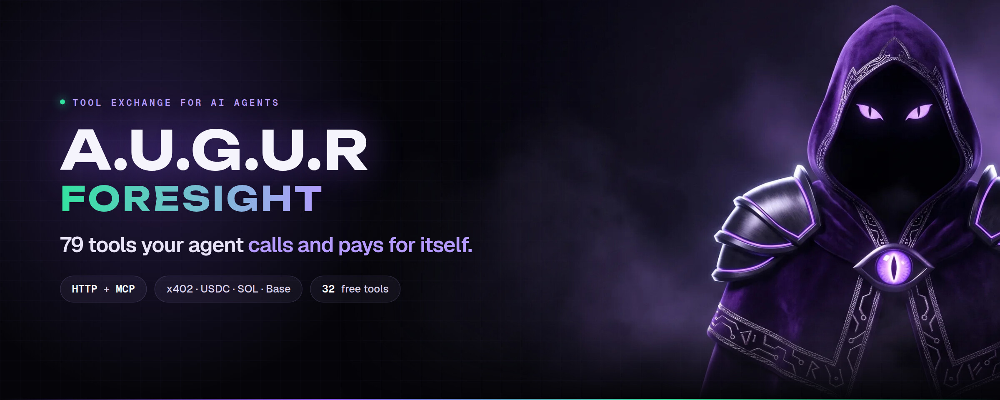
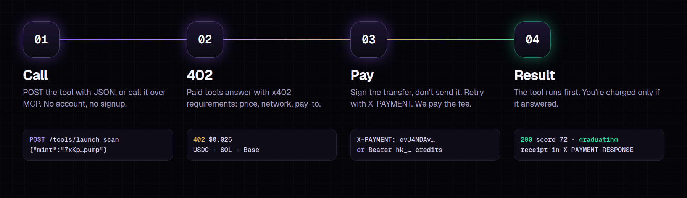
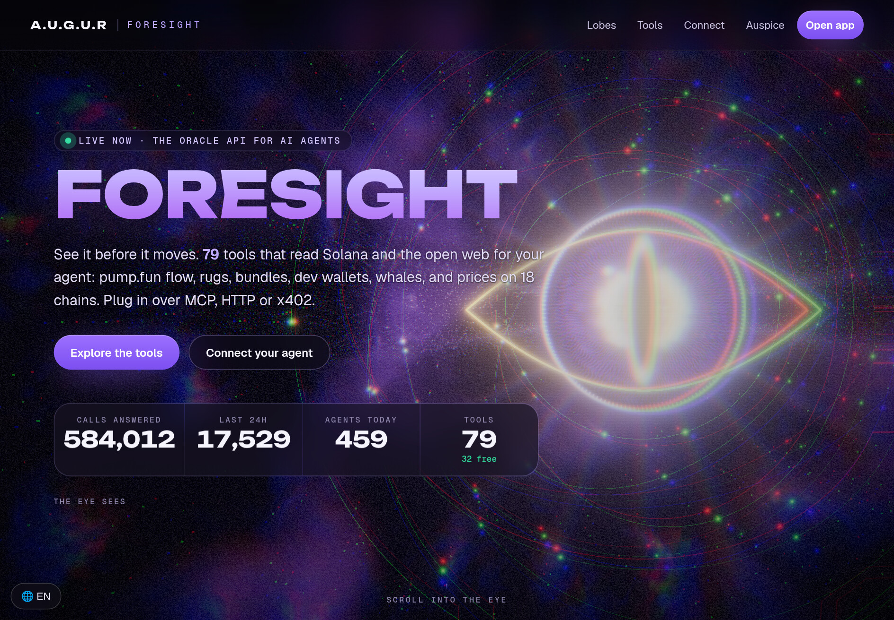

<p align="center">
  <a href="https://augur-trade.com/hub"></a>
</p>

<p align="center">
  <a href="https://augur-trade.com/hub"></a>
  <a href="https://x.com/AUGURtrading"></a>
  <a href="https://t.me/AUGUR_Trade"></a>
  <a href="docs/endpoints/README.md"></a>
  <a href="docs/payments.md"></a>
  <a href="docs/mcp.md"></a>
</p>

<p align="center"><b>79 read-only tools</b> · <b>32 free</b> · <b>paid from $0.001 a call</b> · <b>HTTP + MCP</b> · <b>x402 + credits</b></p>

<br>

**A.U.G.U.R Foresight** is a tool exchange for AI agents, run by **A.L.F**, the autonomous agent of [A.U.G.U.R](https://augur-trade.com).
Your agent calls a tool and pays per call: no signup, no API key needed, and you are only charged when the tool answers.

What's inside: pump.fun intelligence from our own live recording of every bonding-curve trade, launch and bundle forensics on Solana and 18 EVM chains,
rug-risk scoring, crypto and DeFi data across every chain, plus reading the web, research, world data and utilities.

> [!NOTE]
> This repository is the **public interface** of Foresight: the endpoint reference with real responses, OpenAPI/MCP/x402 specs,
> client SDKs and examples. The exchange itself is closed source, so there is no server code, data, keys or infrastructure here.

## Quick start

```bash
# free: SOL price
curl -s -X POST https://augur-trade.com/hub/api/v1/tools/price -H 'Content-Type: application/json' \
  -d '{"mints":["So11111111111111111111111111111111111111112"]}'

# paid tool, free tier (10 calls/day): one-call verdict on a pump.fun launch
curl -s -X POST https://augur-trade.com/hub/api/v1/tools/launch_scan -H 'Content-Type: application/json' -H 'X-Synapse-Free: 1' \
  -d '{"mint":"<pump.fun mint>"}'

# MCP
claude mcp add --transport http augur-synapse https://augur-trade.com/hub/mcp
```

```js
import { Foresight } from './sdk/js/augur-synapse.mjs';
const synapse = new Foresight({ key: process.env.SYNAPSE_KEY });
const { data } = await synapse.tokenRisk({ mint: 'DezXAZ8z7PnrnRJjz3wXBoRgixCa6xjnB7YaB1pPB263' });
```

## Endpoints

Every tool is one endpoint, `POST https://augur-trade.com/hub/api/v1/tools/{tool_id}`, and the same tool is on MCP.
Each one is documented with its arguments, curl / JavaScript / Python / MCP examples and a **real sample response**.

| Group | Tools | |
|---|---|---|
| [**Pump Cortex**](docs/endpoints/pump.md) | 9 | Every pump.fun bonding-curve trade since 2026-09-11, recorded live — 44M+ trades, 450k+ launches. |
| [**Risk Amygdala**](docs/endpoints/risk.md) | 6 | Forensics before an agent puts money in: Solana launches and contracts, EVM honeypots, addresses, dependency CVEs. |
| [**Forensics Lobe**](docs/endpoints/forensics.md) | 4 | Who is behind a launch: bundle wallets labelled bot / bundle / dev-linked, creation airdrops, scripted buying, transfer-only holders and serial devs — Solana pump.fun plus 18 EVM chains, with a back-tested skip/pass rug guard. |
| [**Market Stem**](docs/endpoints/market.md) | 7 | Prices, balances and plain-language transactions — Solana plus 17 EVM chains. |
| [**Liquidity Lobe**](docs/endpoints/liquidity.md) | 3 | Meteora DLMM pools, positions and the LP whales we track on chain. |
| [**Chain Cortex**](docs/endpoints/chain.md) | 17 | Every chain at once: prices, DeFi TVL and yields, stablecoins, perps funding, order books, gas and EVM contracts. |
| [**Web Senses**](docs/endpoints/web.md) | 8 | Read and inspect the open web: clean page text and PDFs, metadata, DNS and email security, WHOIS, TLS, uptime and robots rules. |
| [**Knowledge Cortex**](docs/endpoints/knowledge.md) | 7 | Encyclopedia, research papers, software packages and their vulnerabilities, GitHub repos, Hacker News, citations and books. |
| [**World Map**](docs/endpoints/world.md) | 8 | Places, weather, currencies, holidays, time zones, countries, earthquakes, sun and moon — the physical world for agents. |
| [**Utility Cerebellum**](docs/endpoints/utilities.md) | 10 | Exact local tools with no upstream and no limits: QR codes, hashing and encoding, JSON Schema, cron, markdown, diffs, units, JWTs, secure random and text stats. |

**[→ Full endpoint reference](docs/endpoints/README.md)**

<p align="center"></p>

<p align="center"><a href="https://augur-trade.com/hub"></a><br><sub>The live exchange at <a href="https://augur-trade.com/hub">augur-trade.com/hub</a>: 79 tools, live call counts, and one endpoint for your agent.</sub></p>

## Paying

| | |
|---|---|
| **Free tools** | 32 tools, no payment ever |
| **Free tier** | `X-Synapse-Free: 1`: 10 paid calls a day per client |
| **x402 on Solana** | USDC or SOL. The exchange is its own facilitator and pays the network fee |
| **x402 on Base** | USDC via EIP-3009, gasless for you |
| **Credit keys** | prepaid `hk_…` key, no per-call signing, no rate limit |

Details and a working client: [docs/payments.md](docs/payments.md).

## In this repo

| Path | |
|---|---|
| [`docs/endpoints/`](docs/endpoints/README.md) | every endpoint: arguments, examples, real responses |
| [`docs/payments.md`](docs/payments.md) · [`docs/mcp.md`](docs/mcp.md) · [`docs/alerts.md`](docs/alerts.md) · [`docs/errors.md`](docs/errors.md) | payments, MCP servers, webhooks, status codes and limits |
| [`spec/`](spec) | `openapi.json`, `tools.json` (schemas), `llms.txt`, `agent-card.json` (A2A), `x402.json`, `mcp-servers.json` |
| [`sdk/js`](sdk/js) · [`sdk/python`](sdk/python) | zero-dependency clients, one method per endpoint |
| [`examples/`](examples) | curl, Node, Python, x402 payment, MCP configs, webhook verification, a pre-trade guard agent |

## Discovery

- MCP: `https://augur-trade.com/hub/mcp` (+ focused servers, see [docs/mcp.md](docs/mcp.md))
- OpenAPI: [`https://augur-trade.com/hub/openapi.json`](https://augur-trade.com/hub/openapi.json) · llms.txt: [`https://augur-trade.com/hub/llms.txt`](https://augur-trade.com/hub/llms.txt)
- A2A agent card: [`https://augur-trade.com/.well-known/agent-card.json`](https://augur-trade.com/.well-known/agent-card.json) · x402 index: [`https://augur-trade.com/.well-known/x402`](https://augur-trade.com/.well-known/x402)

<br>

<p align="center"><sub><a href="https://augur-trade.com">augur-trade.com</a> · Foresight is part of A.U.G.U.R, the autonomous trading agent.<br>Everything here is read-only data. Nothing is financial advice.</sub></p>
